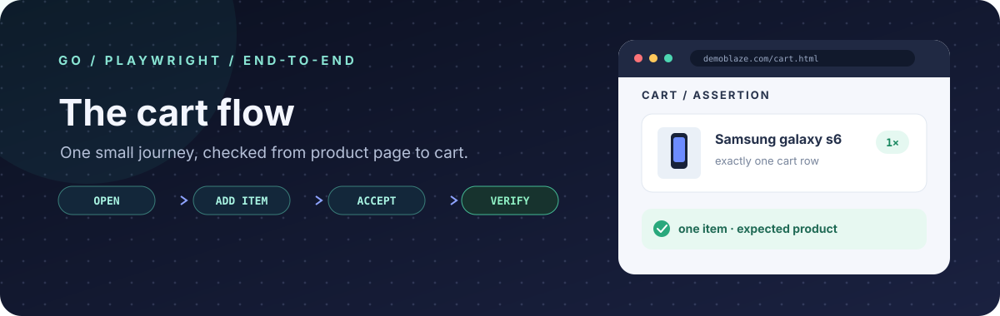

<div align="center">
  
  <p><a href="README.md">🇷🇺 Русский</a> &nbsp;·&nbsp; <strong>🇬🇧 English</strong></p>
</div>

<h1 align="center">DemoBlaze · Cart Flow</h1>

<p align="center">
  A small end-to-end test in Go and Playwright: add one product to the cart and verify the result.
</p>

<p align="center">
  
  
  <a href="https://github.com/olegval26/vk-demoblaze-playwright/actions/workflows/playwright.yml">
    
  </a>
</p>

## The scenario

`DemoBlaze catalog → Samsung galaxy s6 → Add to cart → accept confirmation → Cart`

The test opens [DemoBlaze](https://www.demoblaze.com/), adds **Samsung galaxy s6**, accepts the **Product added** dialog, then checks the cart.

## What it checks

- The product page displays the expected product.
- The browser dialog contains the expected confirmation and is accepted.
- The cart contains exactly one row, and that row is **Samsung galaxy s6**.

The test uses an isolated browser context and Playwright assertions that wait for the expected UI state. It does not rely on fixed pauses.

## Run locally

You need Go 1.25 or newer and an internet connection to install Playwright and Chromium.

```bash
go mod download
go run github.com/mxschmitt/playwright-go/cmd/playwright@v0.6201.1 install chromium
go test -v ./...
```

The test launches Chromium in headless mode.

## Continuous integration

GitHub Actions runs the same test on every push and pull request, and can also be started manually from the **Actions** tab.

## Project map

```text
.
├── .github/workflows/playwright.yml
├── assets/cart-flow.svg
├── cart_test.go
├── go.mod
├── go.sum
├── README.md
└── README.en.md
```

<p align="center">
  <sub>One focused journey: open → add → accept → verify.</sub>
</p>
